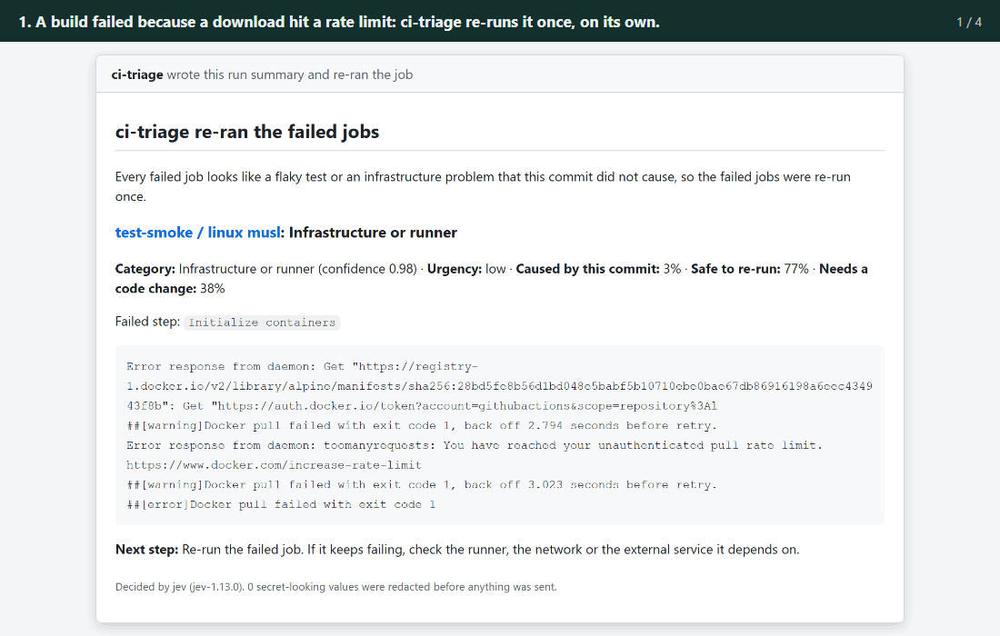
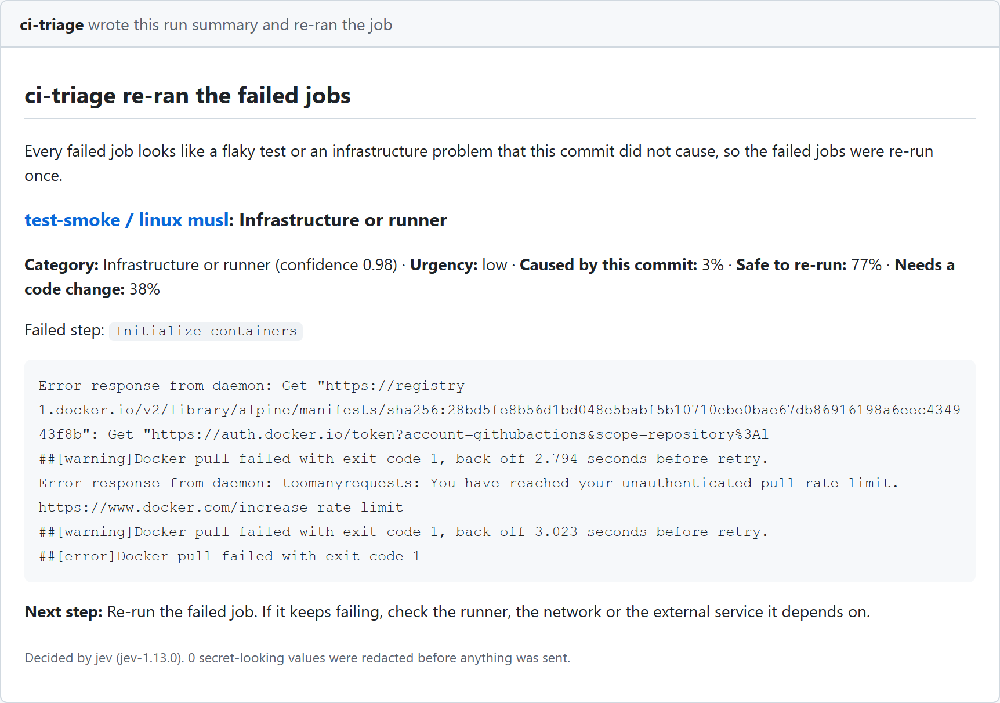
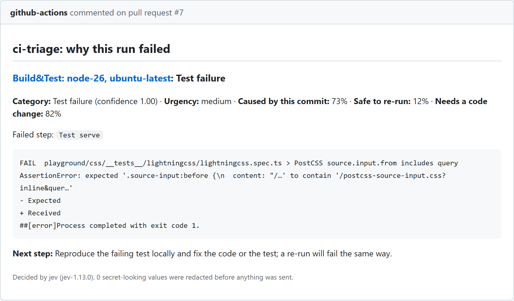
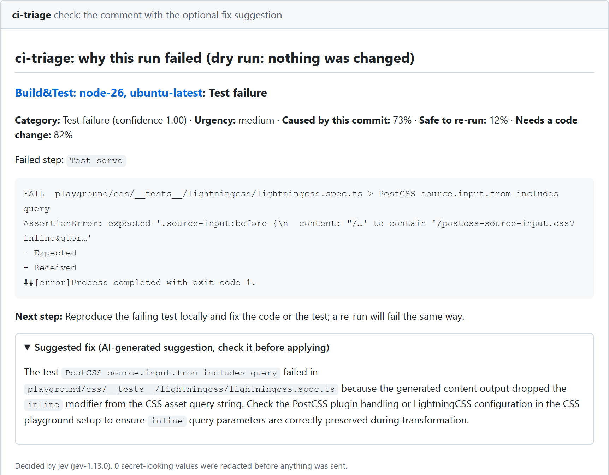
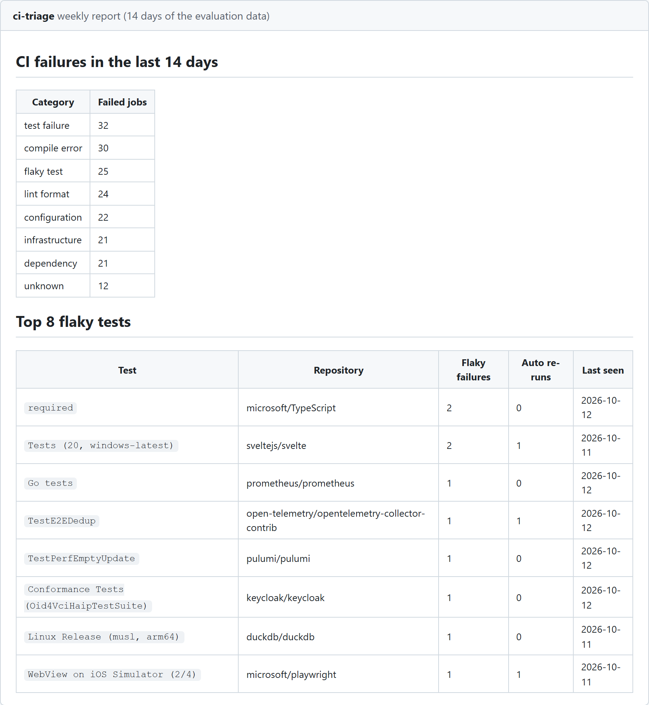
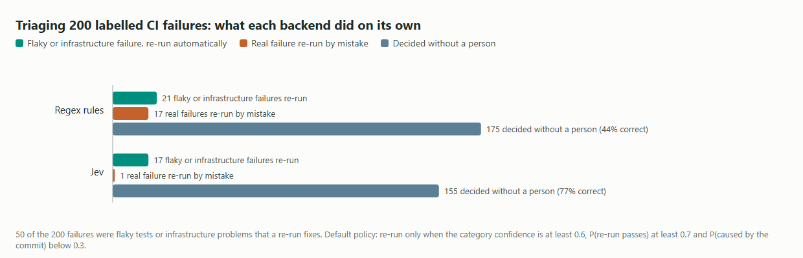
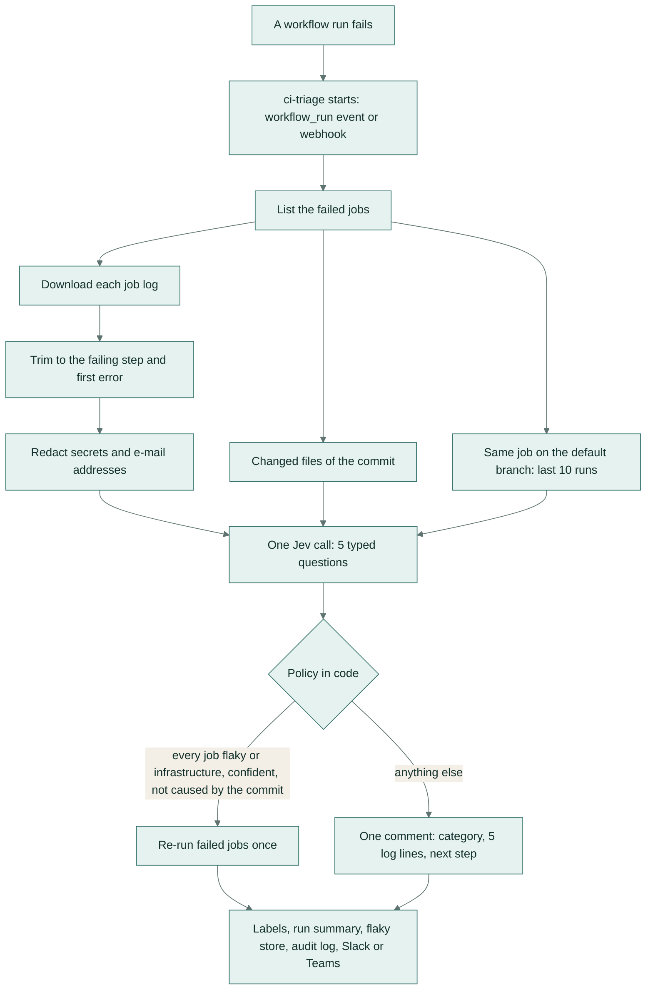
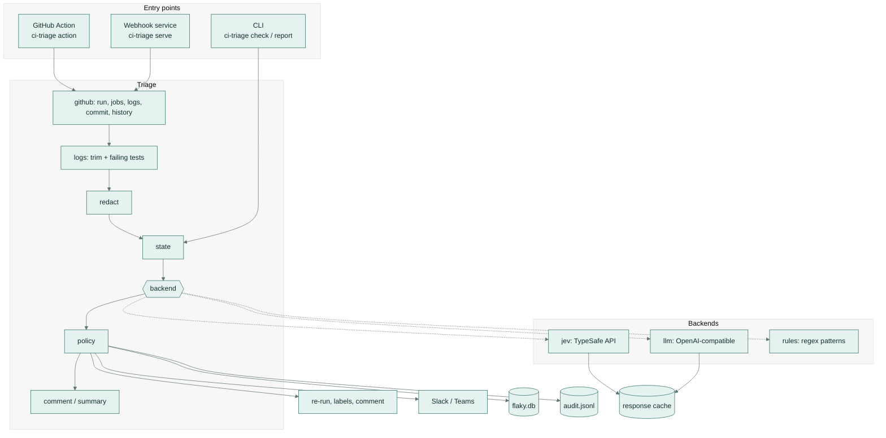
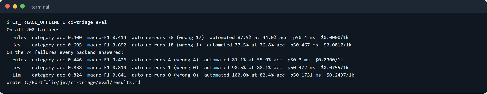

# ci-triage

**Reads a failed CI run and tells the team what kind of failure it is and what to do.** Flaky tests and
infrastructure blips are re-run once, automatically. Real failures get one short comment on the pull request with
the lines of the log that matter and the next step. Built on Jev, TypeSafe AI's typed decision model.



*A failed build goes through ci-triage three ways: a container download that hit a rate limit is re-run on its own,
a real test failure gets a comment that quotes the failing assertion, and every week the team sees which tests fail
most often without a related change.*

## What it does

When a build fails, someone has to open a log that is often thousands of lines long and work out whether the code
is broken or the build machine just had a bad moment. ci-triage does that reading. It re-runs the failures that a
second try will fix, explains the ones that need a person in a single comment, and keeps a list of the tests that
keep failing for no good reason.

## A real-life example

Priya runs the platform team at Tidewell, a 40-developer company that makes scheduling software for clinics. Their
main repository fails CI about 30 times a week. Before ci-triage, whoever was on build duty opened every red build:
about 15 minutes each, close to a full day a week, and roughly a third turned out to be a download timeout or the
same unreliable browser test, fixed by pressing "re-run".

With ci-triage, runner and network failures are re-run by themselves and labelled `ci:auto-rerun`. A real failure
gets one comment that names the failing test, quotes the five lines that matter and says what to do next, so the
author fixes it without asking the build person. On Monday Priya gets a short table of the tests that failed most
often without a related change, and assigns two of them to be fixed. Build duty drops to about an hour a week, and
nobody re-runs a genuinely broken build three times hoping it goes green.

## How you would use it

1. Ask a developer to add the ci-triage workflow file to a repository (about 20 lines, shown below) and save your
   TypeSafe AI key as a secret.
2. Keep working as you do now. Nothing changes until a build fails.
3. When a build fails, ci-triage reads it within a minute. If it is a flaky test or a machine problem, it re-runs the
   build once and adds a label. Otherwise it posts one comment on the pull request explaining what failed.
4. Look at the `ci:` labels to see what kind of failure each red build was. Anything uncertain is labelled
   `ci:needs-human`.
5. Optionally, get a Slack or Teams message when the main branch breaks, and a weekly list of unreliable tests.

## Screenshots

| | |
|---|---|
|  |  |
| **Re-run by itself.** A job failed because the container registry refused to send an image (a rate limit). ci-triage is confident this is a machine problem the commit did not cause, so it re-runs the job once and writes this summary. | **Explained in one comment.** A real test failure in an open-source build tool: the comment names the category, how likely it is that the commit caused it, the failing assertion, and the next step. A re-run would fail the same way, so nothing is re-run. |
|  |  |
| **Optional fix suggestion.** Teams can turn on a one-paragraph suggestion from a general AI model for real failures. It is folded away and clearly marked as a suggestion. | **The weekly report.** Failures by category and the tests that failed most often without a related change, here built from two weeks of the real failures in the evaluation set. |



*On 200 labelled CI failures, the usual pattern rules ("re-run anything that mentions a timeout or a connection
error") re-ran 17 real failures by mistake. ci-triage with Jev re-ran 18 failures on its own, and 17 of them were
flaky tests or machine problems. It decided 155 failures without a person and was right on 77% of those.*

## Results in one table

All numbers come from recorded real API calls on 200 labelled CI failures: 196 real failed jobs from public GitHub
Actions runs of 61 MIT or Apache-2.0 repositories, plus 4 invented excerpts (2%). Full report:
[eval/results.md](eval/results.md); how they were labelled: [eval/LABELLING.md](eval/LABELLING.md).

| On all 200 failures | Regex rules | Jev |
|---|---|---|
| **Real failures re-run by mistake** (default policy) | **17** of 38 re-runs | **1** of 18 re-runs |
| Flaky and infrastructure failures re-run automatically | 21 of 50 | 17 of 50 |
| Category accuracy (8 categories) / macro-F1 | 40.0% / 0.414 | 69.5% / 0.692 |
| Decided without a person (confidence at least 0.6), and correct | 87.5%, 44.0% correct | 77.5%, 76.8% correct |
| Calibration, Brier score of the category (lower is better) | 0.360 | 0.195 |
| "Caused by this commit" / "safe to re-run" / "needs a code change" F1 | 0.683 / 0.494 / 0.724 | 0.793 / 0.688 / 0.832 |
| Time per failure, typical / slowest 5% | under 20 ms | 0.47 s / 0.58 s |
| Cost per 1,000 failures | $0 | $0.082 |

The comparison with a general AI model (Gemini Flash-Lite through its OpenAI-compatible API, asked the same five
questions for a JSON answer with stated probabilities) covers 74 of the 200 failures: the free tier's daily quota ran
out there. Those 74 are the first items of the data file (23 compile errors, 25 configuration, 24 dependency and 2
flaky tests), so they say nothing about re-runs, only about classification:

| On the 74 failures all three answered | Regex rules | Jev | LLM (Gemini Flash-Lite) |
|---|---|---|---|
| Category accuracy / macro-F1 | 44.6% / 0.426 | 83.8% / 0.819 | 82.4% / 0.641 |
| Calibration, Brier score of the category | 0.299 | 0.105 | 0.165 |
| Decided without a person, and correct | 81.1%, 55.0% correct | 90.5%, 88.1% correct | 100%, 82.4% correct |
| Time per failure, typical / slowest 5% | under 20 ms | 0.47 s / 0.59 s | 1.73 s / 3.16 s |
| Cost per 1,000 failures | $0 | $0.076 | $0.244 |

On 196 real failures alone (leaving out the 4 invented ones) Jev's category accuracy is 68.9%.

What the numbers mean:

- **Wrong automatic re-runs** is the number that has to stay near zero: re-running a real failure wastes a build
  and hides the problem for another half hour. Pattern rules that look for words like "timeout" or "connection"
  get this wrong often, because real test failures print those words too.
- **Category accuracy** is how often the eight-way answer (flaky test, real test failure, compile error, lint,
  dependency, infrastructure, configuration, unknown) matched the label. The hardest pair is flaky test versus real
  test failure: from one log alone the two often look identical, which is why ci-triage also sends how often the same
  job failed recently on the main branch.
- **Decided automatically** is the share of failures where the answer was confident enough (0.6) to act on without
  the `ci:needs-human` label, and how often those confident answers were right.

## Rolling it out to a team

A safe rollout takes about two weeks and needs no change to how developers work.

1. **Week 1: watch only.** Add the workflow with `dry-run: "true"`. ci-triage writes its verdict to each failed
   run's summary and changes nothing. Compare its calls with what your build person decided.
2. **Turn on labels and comments.** Set `dry_run: false` and `rerun.enabled: false` in `.github/ci-triage.yml`.
   Every failed pull request now gets a label and one comment; people still press re-run themselves.
3. **Turn on automatic re-runs.** Set `rerun.enabled: true`. Keep `rerun.min_confidence: 0.6`,
   `min_safe_to_rerun: 0.7` and `max_per_day: 10`. ci-triage re-runs a run at most once and never re-runs a run
   that has already been re-run.
4. **Add the guard rails you want.** List jobs that should never be triaged in `ignore_jobs` (deploys, releases).
   Lower `max_per_day` for expensive pipelines.
5. **Wire up notifications and the report.** Point `CI_TRIAGE_SLACK_WEBHOOK` or `CI_TRIAGE_TEAMS_WEBHOOK` at your
   platform channel for main-branch breaks, and add the weekly report workflow. Ship `.ci-triage/audit.jsonl` (or
   the container's `/data/audit.jsonl`) to your log store.
6. **Roll out to more repositories,** or run one self-hosted container for the whole organisation (below).

Who owns what: the platform team owns the policy file and the key; developers only see labels and comments; the
build-duty person works from the `ci:needs-human` label and the weekly report.

---

## How it works

For every failed workflow run ci-triage reads the failed jobs' logs, trims each to the region around the first
failure, removes anything that looks like a secret, asks Jev five typed questions in one call, and lets a small
policy written in code decide what to do.



Step by step:

1. **Trigger.** In GitHub Actions, ci-triage runs on `workflow_run` when your CI workflow completes with a failure.
   The self-hosted service gets the same event by webhook.
2. **Collect.** The failed jobs of the run (up to four), each job's log, the files changed by the commit, and how
   often the same job failed in the last 10 completed runs on the default branch.
3. **Trim.** A job log can be megabytes. ci-triage keeps the failing step, the first assertion, stack trace or
   compiler error in it (with some context), and GitHub's `##[error]` lines: at most about 5,000 characters. It also
   picks out failing test names (pytest, Jest and Vitest, Go, cargo, JUnit).
4. **Redact.** Tokens, keys, passwords in assignments, credentials in URLs, private keys and e-mail addresses are
   replaced before anything leaves the machine ([SECURITY.md](SECURITY.md)).
5. **One Jev call** answers five questions with probabilities (next section).
6. **Policy.** Plain Python decides. A run is re-run only when **every** failed job is a flaky test or an
   infrastructure problem with category confidence of at least 0.6, P(re-run passes) of at least 0.7 and P(caused
   by this commit) below 0.3, the run is on its first attempt, and the daily cap is not reached. Everything else is
   reported. Low confidence or an unknown category adds `ci:needs-human`.
7. **Act and record.** A re-run, labels, one comment per pull request (updated in place), the run summary, a
   Slack or Teams message for main-branch breaks, a row per failing test in the flaky-test store, and one JSONL
   audit line per job.

### The Jev call

Jev is not a chat model: it takes a "state" and named, typed questions and returns typed answers with
probabilities, in one call of about half a second. ci-triage asks:

| Question | Type | Answer |
|---|---|---|
| `category` | Choice | flaky test, real test failure, compile or type error, lint or format, dependency or lockfile, infrastructure or runner, configuration or secrets, unknown |
| `caused_by_commit` | Noul | probability that the changes in this commit caused the failure |
| `safe_to_rerun` | Noul | probability that re-running without any change would pass |
| `needs_code_change` | Noul | probability that a commit is needed to make the job pass |
| `urgency` | Score | 0 low (a blip), 1 blocks one pull request, 2 breaks the default branch or a release |

The state is the workflow and job name, the failing step, the branch type, the first line of the commit message, up
to 25 changed file paths, the default-branch history in words ("occasionally: the same job failed in 2 of the last
10 runs on main") and the trimmed log excerpt.

### The optional fix suggestion

With `suggest.enabled: true` and an `AI_API_KEY`, real failures (test, compile, lint, dependency) also get one
paragraph from an OpenAI-compatible model, cached on disk and shown folded away as an AI-generated suggestion. It
never decides anything.

### Architecture



All three backends implement one interface (`decide(failure) -> Decision`), so the policy, comment and evaluation
treat them the same. Responses are cached on disk by request hash; the evaluation and CI replay the cache and never
call a live API.

## Setup and usage

### As a GitHub Action

Add `.github/workflows/ci-triage.yml` to a repository (also in [examples/ci-triage-workflow.yml](examples/ci-triage-workflow.yml)):

```yaml
name: ci-triage
on:
  workflow_run:
    workflows: ["CI"]          # the name of your test workflow
    types: [completed]
permissions:
  actions: write               # re-run failed jobs; flaky-test store in the Actions cache
  pull-requests: write
  issues: write
  contents: read
jobs:
  triage:
    if: github.event.workflow_run.conclusion == 'failure'
    runs-on: ubuntu-latest
    steps:
      - uses: actions/checkout@v4
      - uses: samiulhuda360/ci-triage@v1
        with:
          typesafe-api-key: ${{ secrets.TYPESAFE_API_KEY }}
```

Action inputs: `typesafe-api-key`, `github-token` (defaults to the job token), `config` (default
`.github/ci-triage.yml`), `dry-run`, `backend`, `command` (`triage` or `report`), `persist-store`, `ai-api-key`.
Outputs: `action` (`rerun`, `report` or `skipped`) and `category`. The weekly report is a scheduled workflow in
[examples/ci-triage-weekly.yml](examples/ci-triage-weekly.yml).

### Policy file

`.github/ci-triage.yml`, every key optional (full list with defaults in [examples/ci-triage.yml](examples/ci-triage.yml)):

```yaml
rerun:
  min_confidence: 0.6        # Jev's category confidence needed to re-run without a person
  min_safe_to_rerun: 0.7     # P(a re-run passes)
  max_caused_by_commit: 0.3  # P(this commit caused it) must stay below this
  max_per_day: 10
labels:
  prefix: "ci:"
notify:
  default_branch_only: true
suggest:
  enabled: false
ignore_jobs: [deploy]
```

### As a self-hosted webhook service

One container can serve every repository in an organisation. It reads each repository's `.github/ci-triage.yml`
through the API and keeps the flaky-test store and audit log on a volume.

```bash
docker build -t ci-triage .
docker run -d -p 8080:8080 -v ci-triage-data:/data \
  -e CI_TRIAGE_WEBHOOK_SECRET -e GITHUB_TOKEN -e TYPESAFE_API_KEY ci-triage
```

Point a GitHub App or organisation webhook at `https://<host>/webhook` with the same secret, sending **Workflow
runs** events. Unsigned or wrongly signed requests get `401`; `GET /healthz` answers `{"ok": true}`.

### Locally, from the command line

```bash
python -m venv .venv && . .venv/bin/activate      # Windows: .venv\Scripts\activate
pip install -e ".[dev]"

# Triage a recorded failure (no key needed: replays the cached Jev answer)
CI_TRIAGE_OFFLINE=1 ci-triage check fixtures/test-failure.json --backend jev --cache eval/cache

# The Action's full code path against a local stand-in for the GitHub API
python scripts/demo_github.py fixtures/infra-rerun.json

# Triage a real failed run of your own repository (needs GITHUB_TOKEN and TYPESAFE_API_KEY)
ci-triage action --repo your-org/your-repo --run-id 123456789 --dry-run

# Weekly report from the store
ci-triage report --days 7

# Re-run the evaluation from the recorded responses
CI_TRIAGE_OFFLINE=1 ci-triage eval
```

### Configuration (environment variables)

| Variable | Used for |
|---|---|
| `TYPESAFE_API_KEY` | the Jev backend (without it, `backend: auto` uses the regex rules) |
| `GITHUB_TOKEN` | reading runs, jobs and logs; re-running, labelling and commenting |
| `AI_API_KEY`, `AI_BASE_URL`, `AI_MODEL`, `AI_MIN_INTERVAL` | the optional `llm` backend and the fix suggestion (any OpenAI-compatible endpoint) |
| `CI_TRIAGE_WEBHOOK_SECRET` | the webhook service (required there) |
| `CI_TRIAGE_SLACK_WEBHOOK`, `CI_TRIAGE_TEAMS_WEBHOOK` | chat notifications (names can be changed in the policy) |
| `CI_TRIAGE_BACKEND`, `CI_TRIAGE_CONFIG`, `CI_TRIAGE_DRY_RUN` | overrides set by the Action inputs and the service |
| `CI_TRIAGE_STORE`, `CI_TRIAGE_AUDIT_LOG`, `CI_TRIAGE_CACHE_DIR` | where the service keeps its store, audit log and response cache |
| `CI_TRIAGE_OFFLINE` | `1` replays cached responses only and never calls an API (CI) |

## Evaluation

**Data.** 200 failed CI jobs, 25 per category. 196 are real: failed jobs and re-run attempts from the public GitHub
Actions runs of 61 repositories that GitHub reports as MIT or Apache-2.0, fetched with `gh api`
([scripts/harvest.py](scripts/harvest.py)), trimmed and redacted by the same code ci-triage runs. 32 of them failed
and then passed when GitHub re-ran the same commit, which is the strongest evidence of a flaky test or a machine
problem. 4 excerpts (2%) are invented, clearly marked, to round out compile errors, dependency problems and unknown
failures. Every real record links to its run and job in [eval/data/SOURCES.md](eval/data/SOURCES.md). Each item was
labelled by the written rules in [eval/LABELLING.md](eval/LABELLING.md): the category, the three yes/no answers and
the urgency.

**What is measured** (`ci-triage eval`, report in [eval/results.md](eval/results.md)):

- the full policy: automatic re-runs, wrong re-runs (gold category not flaky or infrastructure) and the share of
  flaky and infrastructure failures re-run;
- the share of failures decided automatically at confidence thresholds from 0.3 to 0.9, and the accuracy on that
  share (the rest are escalated with `ci:needs-human`);
- category accuracy, macro-F1, per-category F1 and the confusion matrix; accuracy, F1 and Brier score of the three
  yes/no answers; urgency accuracy;
- calibration: Brier score and a reliability table;
- latency (p50, p95) and cost per 1,000 failures from real token counts.

The re-run gate trades coverage for safety. Same policy, changing only the minimum P(safe to re-run) on all 200
failures:

| Minimum P(safe to re-run) | Jev: re-runs / real failures re-run / flaky and infra re-run | Regex rules |
|---|---|---|
| 0.5 | 30 / 3 / 54% | 38 / 17 / 42% |
| 0.7 (default) | 18 / 1 / 34% | 38 / 17 / 42% |
| 0.8 | 5 / 1 / 8% | 38 / 17 / 42% |

Where Jev is still weak: flaky test versus real test failure (F1 0.46 and 0.50; 9 of 25 flaky tests were called real
failures, 7 real failures were called flaky), the unknown category (F1 0.42), and urgency (59.5% exact, against 75.0%
for the rules, which read the branch type directly). The category answers are well calibrated where it matters:
when Jev states more than 0.9 it is right 85% of the time. Per-category tables, confusion matrices and reliability
tables for every backend are in [eval/results.md](eval/results.md).



*`ci-triage eval` replays the recorded answers and prints the headline numbers for each backend.*

**Spend.** The evaluation and demos used 203 Jev calls (about 394,000 input and 31,000 output tokens, about $0.017 in
total) and 75 successful Gemini calls on the free tier (about 129,000 input and 13,000 output tokens).

## Tests and CI

```bash
ruff check . && ruff format --check . && mypy . && pytest
```

50 tests cover log trimming, key lines and failing-test names for pytest, Jest and Vitest, Go, cargo and JUnit;
secret and e-mail redaction (including the cases that must not be redacted); the state sent to a backend; the Jev
and LLM backends with fake transports, retries, cache replay and offline mode; the regex rules; every re-run
blocker, the daily cap and the "re-run once" rule; the policy file; the comment; the SQLite store and weekly report;
the GitHub client against a fake API (re-run, label upkeep, comment upsert, fork pull requests, dry run); webhook
signatures and event filtering; and an offline replay of the whole evaluation with dataset consistency checks. The
CI workflow runs the same commands, replays the evaluation and fails if `eval/results.md` changes, triages every
fixture, and runs the Action code path against the local GitHub stand-in. CI never calls a model.

## Project structure

```
ci_triage/
  cli.py            check, action, serve, report, eval
  triage.py         one run: collect jobs, decide, apply the policy, act, notify, record, audit
  logs.py           trim a job log to the failure region; key lines; failing test names
  redact.py         secret and e-mail redaction
  state.py          the state sent to a backend
  questions.py      the five typed questions
  models.py         categories, Failure, Decision
  backends/         jev.py, llm.py, rules.py, base.py (interface, confidence formulas)
  config.py         reads .github/ci-triage.yml
  policy.py         re-run rules, labels, next steps
  comment.py        the PR comment and run summary
  github.py         REST client: runs, jobs, logs, history, re-run, labels, comments
  store.py          SQLite flaky-test store and weekly report
  suggest.py        optional LLM fix suggestion (cached)
  server.py         webhook service with HMAC checks
  notify.py         Slack / Teams
  audit.py          JSONL audit log
  evaluate.py       the evaluation and results.md
  metrics.py        accuracy, F1, Brier, reliability
eval/
  data/             failures.jsonl, labels.jsonl, labels_sheet.txt, invented.jsonl, SOURCES.md
  cache/            recorded Jev and LLM responses (replayed offline)
  LABELLING.md      the labelling guide
  results.md        the latest evaluation
examples/           workflow, weekly report workflow and policy file to copy
fixtures/           five real failures for the CLI and the demo
scripts/            harvest.py, build_dataset.py, demo_github.py, demo_report.py, make_chart.py
action.yml          the composite GitHub Action
Dockerfile          the webhook service image
SECURITY.md         what is redacted, what is sent, permissions, reporting
```

## Tech stack

Python 3.11+, httpx, PyYAML, SQLite and the standard-library HTTP server; Jev (TypeSafe AI System One API) for
decisions; an OpenAI-compatible model (Gemini Flash-Lite in the evaluation) as the comparison backend and for the
optional suggestion; GitHub REST API and `gh api` for public data; pytest, ruff and mypy; GitHub Actions (composite
action) and Docker.

## Security and data handling

Logs can contain secrets, so ci-triage sends only a trimmed, redacted excerpt of each failed job (about 5,000
characters at most), job and step names, the branch type, the first line of the commit message, changed file
paths and two numbers of default-branch history: never whole logs, source code or diffs. What is redacted, what is
sent where, and the permissions it needs: [SECURITY.md](SECURITY.md).

ci-triage is an independent project and is not affiliated with TypeSafe AI.

## Licence

MIT, see [LICENSE](LICENSE). The log excerpts in `eval/data/` come from public CI runs of projects licensed MIT or
Apache-2.0 and are used under those licences, listed with their run links in
[eval/data/SOURCES.md](eval/data/SOURCES.md).
